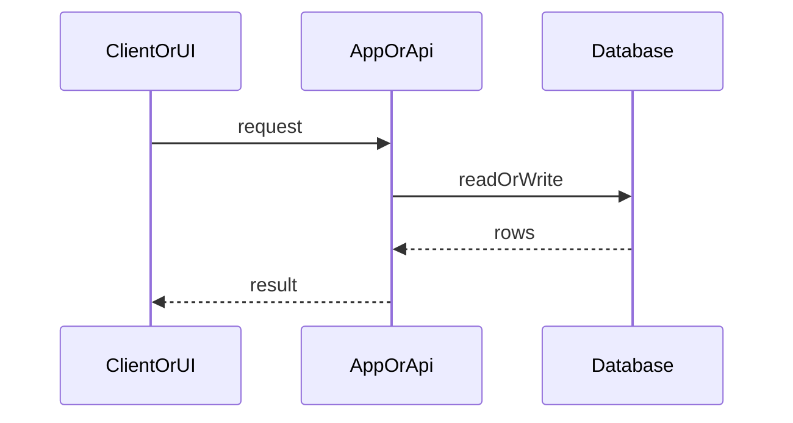

Copy into `.my-docs/workflow/<slug>/`. [handoffs.md](../handoffs.md) · [CUTOVER.md](../CUTOVER.md).

# 03-design.md

Minimal skeleton. Keep **required headings** even when N/A. Expand sections when Has API/DB/UI = yes or Mode **full**.

````markdown
# Design: <short title>

**Mode:** full | simple — from `00-run.md`

## Decision 1: which design approach?

### Option 1 — <short name> (required)

**What it is:**
**Example:**
**Pros:**
-
**Cons:**
-

### Option 2 — <short name>

<!-- Mode full: required. Mode simple: replace with "Rejected alternative (≤3 lines): …" unless 2+ approaches unsettled. -->

**What it is:**
**Example:**
**Pros:**
-
**Cons:**
-

## Tradeoffs

<!-- Mode full: fill table. Mode simple: optional one-line note. -->

| Factor | Option 1 | Option 2 |
|--------|----------|----------|
| Cost / time | | |
| Complexity | | |
| Usability | | |
| Failure cases | | |

## Recommendation

**Pick Option N** because …

## Chosen design (user-approved)

<!-- Fill after Gate B -->

## System design

**Required heading** — Overview **or** `N/A — no system-design change; <reason>`.

Expand when Has API=yes, Has DB=yes, or Mode **full** with new trust boundary / data flow. Prefer repo architecture first. Point to Sequence / Contracts / OWASP — do not restate field lists here.

### Overview

- **What it is:**
- **Components / boundaries:**
- **Data flow:**
- **Consistency & failure:**
- **Why this shape:**
- **Best practices / anti-patterns:**
- **Reference:**

<!-- Optional Concept N (≤3) when Mode full teaches a named system idea. -->

## Sequence diagram

<!-- Required heading. Mode simple + no API/DB: stub or N/A note OK. Else fill main request path. -->



## Contracts

### API contracts

<!-- Expand when Has API = yes. Else: `N/A — Has API = no`. -->

| Item | Detail |
|------|--------|
| Method + path (or name) | |
| Auth / who can call | |
| Request fields | |
| Success response | |
| Errors | |
| Downstream calls | |

### Database contracts

<!-- Expand when Has DB = yes. Else: `N/A — Has DB = no`. -->

| Table / collection | Purpose | Key fields | Indexes / uniques | Write owner | Read owners |
|--------------------|---------|------------|-------------------|-------------|-------------|
| | | | | | |

### Example queries

<!-- When Has DB = yes: 1–3 happy-path examples. Else N/A. -->

## Design patterns used

**Required heading** — Pattern N **or** `N/A — no named pattern beyond local conventions; <reason>`.

### Pattern N — <name>

- **What it is:**
- **How we use it here:**
- **Why we chose it:**
- **Best practices / anti-patterns:**
- **Reference:**

## UI / UX / mobile

<!-- Has UI = no → `N/A — no UI`. Has UI = yes → fill; Mode simple: thin alignment (layout + #1/#2 + chrome lock), not full Gate A. -->

- **UI (when Has UI):**
- **Build ↔ UI lock:**
- **80/20 UI (when UI):** Important #1 / #2; core actions dominant
- **Layout / hierarchy:**
- **Loading / empty / error / success:**
- **Mobile / a11y basics:**

## Security design review (OWASP)

<!-- Mode full or auth/PII/schema in scope: fill. Mode simple + low risk: light table or N/A with reason. -->

Trust boundaries:

-

Abuse cases:

-

| OWASP | Status | Note |
|-------|--------|------|
| A01–A10 | | See https://owasp.org/Top10/ |

## Challenges answered

- Do we need this?
- What fails?
- Is this overspecified?

## Domain / ADR notes

- **Glossary terms used:**
- **ADR:** path or `N/A — skipped: <reason>`
- **Grill locks honored:** from `02b` or N/A
````
---
