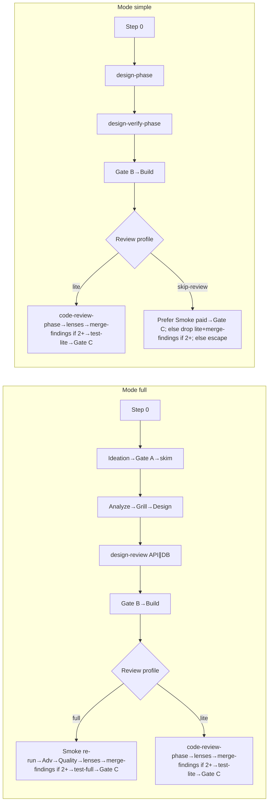

# Stage index (canonical)

**SoT for:** Happy path, Mode × Review profile post-Build, Status vs stage, Slug, Cheap path, Gates.

| Concern | File |
|---------|------|
| Step 0 / Mode / profile | [step-0.md](step-0.md) |
| Resume / abort | [resume.md](resume.md) |
| Design-backloop | [design-backloop.md](design-backloop.md) |
| Preflight / derive | [preflight.md](preflight.md) · [derive-next.md](derive-next.md) |
| HITL / Gate B / Gate C | [hitl.md](hitl.md) · [gate-b.md](gate-b.md) · [gate-c.md](gate-c.md) |
| Results / Verify / Lenses | [results.md](results.md) · [verify.md](verify.md) · [lenses.md](lenses.md) |
| Next → open files | [parent-next.md](parent-next.md) |

**Progress:** ≤5 lines + path after each step; Result header ~40 lines; update card.

## Status vs stage id

| Field | Allowed | Role |
|-------|---------|------|
| **Status** | `running` \| `paused` \| `stopped` \| `done` | Lifecycle only |
| **Last stage** / card **Stage id** | handoffs ids (+ `gate-b` / `gate-c`) | Pipeline position |

**Done:** Status `done` only after Merge Result **success** and `merge` ∈ **Gate C approved**. Abort → `stopped`. PR-only subset → stay `paused`.

**Calibration (after `done`):** append ≤3 lines to `.my-docs/workflow/_calibration.md`: Mode OK? · Review profile OK? · Biggest friction stage?

## Happy path

### Mode × Review profile → post-Build

| Mode | Review profile | After Build verify-pass + Smoke section |
|------|----------------|------------------------------------------|
| **full** | **full** | Notes `smoke re-run` once → independent Smoke → `smoke-pass (re-run)` → Adv → Quality → lenses → `merge-findings` if 2+ → `test-full` → Gate C |
| **full** | **lite** | Skip Smoke Task (Build-writes-Smoke) → `code-review-phase` → lenses per plan → `merge-findings` if 2+ → `test-lite` → Gate C |
| **simple** | **lite** | Same as full+lite |
| **simple** | **skip-review** | Legal only per [lenses.md](lenses.md); ordered recovery ([verify.md](verify.md) Skip-review + Smoke): Prefer unpaid `smoke re-run` → Smoke; Prefer paid (Notes `smoke-pass (re-run)` + provenance `smoke-pass-rerun`) → Gate C; else peer alternatives — drop to lite (`code-review-phase` → lenses → `merge-findings` if 2+ → `test-lite`) **or** Gate C escape+provenance ([gate-c.md](gate-c.md)) |

**Forbidden:** Mode simple + profile full; Mode full + skip-review. Illegal combos are **never** unlocked by `card-override` — reclassify Mode/profile instead. `card-override` is only for Next↔derive mismatch ([derive-next.md](derive-next.md) · [hitl.md](hitl.md)).

### Full pipeline order

1. Step 0 — Mode full; profile full|lite; seed `00-run.md`; [preflight.md](preflight.md) seed check
2. Ideation (set Has UI)
3. Gate A → `01a` (auto when ok; max 3 rounds)
4. Light skim → `02-skim.md` (fail-closed until `01a` = `ok`)
5. Analyze → Grill → Design (two options); set Has API/DB
6. Design ↔ review until clean — both Has API+DB → same-turn parallel API∥DB when both `03a-*` missing
7. Optional TDD review (`04a`) if planned tests
8. Gate B — [gate-b.md](gate-b.md) (Mode full = blocking)
9. Build → verify-pass + Smoke section (max 3)
10. Post-Build per table above
11. Review ⇄ Fix (max 3) → Test ⇄ Fix (max 3)
12. Gate C blocking → merge → `done`

### Simple pipeline order

1. Step 0 — Mode simple; profile lite|skip-review; bootstrap `01-idea` if needed
2. `design-phase` (Analyze+Grill+Design)
3. `design-verify-phase` until clean (max 3)
4. Optional 04a → Gate B → Build (Gate B: auto only if API=no DB=no auth/PII/schema=no; else blocking)
5. After Build verify-pass + Smoke section:
   - **(a) skip-review** — ordered recovery per [verify.md](verify.md) Skip-review + Smoke: Prefer unpaid `smoke re-run` → Smoke; Prefer paid Notes `smoke-pass (re-run)` ↔ provenance `smoke-pass-rerun` → Gate C; else peer alternatives — drop skip-review → lite (`code-review-phase` → lenses → `merge-findings` if 2+ → `test-lite`) **or** Gate C escape+provenance ([gate-c.md](gate-c.md))
   - **(b) lite** — `code-review-phase` → lenses per plan → `merge-findings` if 2+ → `test-lite` → Gate C
6. Merge → `done` + calibration

## Slug

`YYYYMMDD-feature-x` (UTC + kebab). Folder: `.my-docs/workflow/<slug>/`.

## Cheap path

| Ask looks like | Mode | Review profile |
|----------------|------|----------------|
| Copy / token / docs-only | simple | skip-review |
| Bug fix / one helper / tiny UI | simple | lite |
| Clear small feature, no new auth/schema | simple | lite |
| New/changed public API or persistence | **full** (unless [tiny tweak](lenses.md)) | never skip-review |
| Ambiguous / invent *what* | full or [myplan](step-0.md) first | full |

## Gates

| Gate | When | Who |
|------|------|-----|
| **A** | After Ideation (full) | Auto when `01a` ok |
| **B** | After design clean (+04a); before Build | HITL ([gate-b.md](gate-b.md)) |
| **C** | Before commit/push/PR/merge | Always blocking ([gate-c.md](gate-c.md)) |
