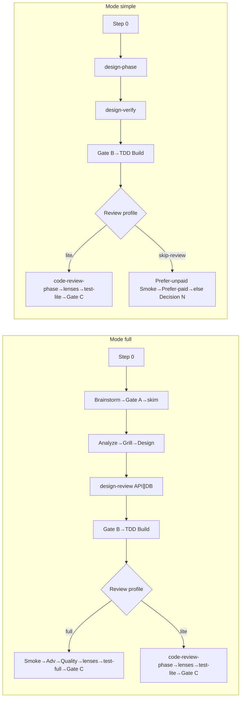

# Stage index (canonical)

**SoT for:** Happy path, Mode × Review profile, Status vs stage, Forbidden combos.

| Concern | File |
|---------|------|
| Step 0 / Mode / profile | [step-0.md](step-0.md) |
| Next stage | [derive-next.md](derive-next.md) |
| Preflight | [preflight.md](preflight.md) |
| HITL / Gate B / Gate C | [hitl.md](hitl.md) · [gate-b.md](gate-b.md) · [gate-c.md](gate-c.md) |
| Results / Verify / Lenses | [results.md](results.md) · [verify.md](verify.md) · [lenses.md](lenses.md) |
| Open files | [parent-next.md](parent-next.md) |

**Progress:** ≤5 lines + path after each step; update `00-run.md` card.

## Status vs stage

| Field | Allowed | Role |
|-------|---------|------|
| **Status** | `running` \| `paused` \| `stopped` \| `done` | Lifecycle |
| **Last stage** / card **Next** | handoff ids (+ `gate-b` / `gate-c`) | Pipeline position |

**Done:** only after Merge Result **success** and `merge` ∈ **Gate C approved**.  
**PR-only subset:** stay `paused`. Abort → `stopped`.

## Happy path

### Mode × Review profile (post-Build)

| Mode | Profile | After Build verify-pass |
|------|---------|-------------------------|
| **full** | **full** | Independent Smoke (`Smoke source: Smoke-Task`) → Adv → Quality → lenses → `merge-findings` if 2+ → `test-full` → Gate C |
| **full** | **lite** | Build-writes-Smoke may pay → `code-review-phase` → lenses → `test-lite` → Gate C |
| **simple** | **lite** | Same as full+lite |
| **simple** | **skip-review** | Legal only per [lenses.md](lenses.md). Ordered: Prefer unpaid Smoke → Prefer paid ([verify.md](verify.md)) → else Decision N. Prefer paid → `merge` if bar met **and** `merge` ∈ approved; else → `gate-c` |

### Forbidden (never unlocked by Decision N or `card-override`)

- Mode **simple** + profile **full**
- Mode **full** + **skip-review**
- **skip-review** when Has API **or** Has DB **or** Has auth/PII/schema = **yes** → drop to lite (or reclassify) + Gate B **blocking**

`card-override` is only for Next↔derive mismatch ([hitl.md](hitl.md)).

## Pipeline order

### Mode full

1. Step 0 — seed card; Mode full; profile full|lite  
2. Brainstorm / Ideation (Has UI) — hard-gate shared understanding  
3. Gate A → skim  
4. Analyze → Grill (frontier empty) → Design (two options)  
5. Design-review (API∥DB parallel when both unpaid) until Design clean  
6. Optional TDD plan review (`04a`)  
7. Gate B (**blocking**) → settle gen token  
8. Build (TDD) → verify-pass (max 3)  
9. Post-Build per table  
10. Fix loops (max 3) → Gate C → merge → `done`

### Mode simple

1. Step 0 — Mode simple; profile lite|skip-review (if legal)  
2. `design-phase` (Analyze+Grill+Design bundled)  
3. `design-verify-phase` until Design clean  
4. Gate B (auto only if API=no DB=no auth=no; else blocking)  
5. Build → Post-Build per profile  
6. Gate C → merge → `done`

## Slug

`YYYYMMDD-feature-x` (UTC date + kebab). Folder: `.my-docs/workflow/<slug>/`.

## Cheap path (default classify)

| Ask looks like | Mode | Profile |
|----------------|------|---------|
| Copy / docs-only / token tweak | simple | skip-review |
| Bug fix / one helper / tiny UI | simple | lite |
| Small feature, no auth/schema | simple | lite |
| New API/DB/auth or multi-surface | full | full or lite |

## Calibration (after `done`)

Append ≤3 lines to `.my-docs/workflow/_calibration.md`: Mode OK? · Profile OK? · Biggest friction?
