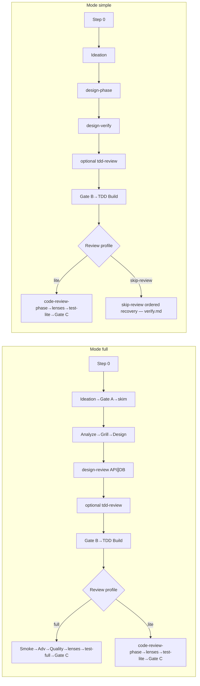

# Stage index (canonical)

**SoT for:** Happy path, Mode × Review profile, Status vs stage, Forbidden combos.

| Concern | File |
|---------|------|
| Step 0 / Mode / profile | [step-0.md](step-0.md) |
| Next stage | [derive-next.md](derive-next.md) |
| Preflight | [preflight.md](preflight.md) |
| Clarity-check (design / grill / merge) | [clarity-check.md](clarity-check.md) · [preflight.md](preflight.md) Always §6 |
| HITL / Gate B / Gate C | [hitl.md](hitl.md) · [gate-b.md](gate-b.md) · [gate-c.md](gate-c.md) |
| Results / Verify / Lenses | [results.md](results.md) · [verify.md](verify.md) · [lenses.md](lenses.md) |
| Open files | [parent-next.md](parent-next.md) |

**Progress:** ≤5 lines + path after each step; update `00-run.md` card.

## Status vs stage

| Field | Allowed | Role |
|-------|---------|------|
| **Status** | `running` \| `paused` \| `stopped` \| `done` | Lifecycle |
| **Last stage** / card **Next** | handoff ids (+ `gate-b` / `gate-c`) | Pipeline position |

**Done:** only after Merge Result **success** and `merge` ∈ **Gate C approved**.  
**PR-only subset:** stay `paused`. Abort → `stopped`.

## Happy path

Skip-review node caption: SoT = [verify.md](verify.md) **Skip-review ordered recovery** (pointer only — do not invent a shorter order).

### Mode × Review profile (post-Build)

| Mode | Profile | After Build verify-pass |
|------|---------|-------------------------|
| **full** | **full** | Independent Smoke (`Smoke source: Smoke-Task`) → Adv → Quality → lenses → `merge-findings` if 2+ → `test-full` → Gate C |
| **full** | **lite** | Build-writes-Smoke may pay → `code-review-phase` → lenses → `test-lite` → Gate C |
| **simple** | **lite** | Same as full+lite |
| **simple** | **skip-review** | Legal only per [lenses.md](lenses.md). Ordered recovery SoT: [verify.md](verify.md) **Skip-review ordered recovery** (pointer only). |

### Forbidden (never unlocked by Decision N or `card-override`)

- Mode **simple** + profile **full**
- Mode **full** + **skip-review**
- **skip-review** when Has UI **or** Has API **or** Has DB **or** Has auth/PII/schema = **yes** **or** `unknown` → drop to lite (or reclassify) (`unknown` ≠ `no` — [lenses.md](lenses.md)). Has UI=`yes`\|`unknown` fail-closes **skip-review only** (not Gate B auto). API/DB/auth yes\|`unknown` → Gate B **blocking** ([gate-b.md](gate-b.md))

`card-override` is only for Next↔derive mismatch ([hitl.md](hitl.md)).

## Pipeline order

### Mode full

1. Step 0 — seed **only** `00-run.md`; Mode full; profile full|lite  
2. Ideation — hard-gate (**always**); paid = Notes `ideation-confirmed` + provenance **or** Notes `ideation-skip` → write `01-idea`  
3. Gate A → skim → Analyze → Grill (`frontier-empty` or Notes `grill-skip` — not template `pending` / Result `skipped`) → Design (two options; Prefer `design` when ¬ Design present)  
4. Design-review (API∥DB parallel when both unpaid) until Design clean — only after Design present (`03` + Result `done`)  
5. Optional TDD plan review (`04a`) — Prefer `tdd-review` **only** when **04a unpaid / dirty** (planned tests present ∧ ¬skip ∧ Result ∉ {`clean`}, incl. `pending`); waiver = Notes `04a skipped` (parent-only named yes — [hitl.md](hitl.md)); Prefer `gate-b` when Design clean ∧ **04a ok** (incl. ¬ planned tests) ([derive-next.md](derive-next.md))  
6. Gate B (**blocking**) → settle gen token  
7. Build (TDD) → verify-pass (max 3)  
8. Post-Build per table  
9. Fix loops (max 3) → Gate C → merge → `done`

### Mode simple

1. Step 0 — seed **only** `00-run.md`; Mode simple; profile lite|skip-review (if legal)  
2. Prefer `ideation` while **ideation unpaid** ([derive-next.md](derive-next.md) · [brainstorm.md](brainstorm.md)) → then Prefer `design-phase` while ¬ Design present (Analyze+Grill+Design bundled; cold start carve — [grill.md](grill.md))  
3. `design-verify-phase` until Design clean (only after Design present; Verify clean ≡ Design clean; stage writes Isolated when Has API/DB ∈ {yes, unknown} ∧ ¬tiny)  
4. Optional `tdd-review` **only** when **04a unpaid / dirty** (incl. Result `pending`); waiver = Notes `04a skipped` (parent-only named yes — [hitl.md](hitl.md)); Prefer `gate-b` when Design clean ∧ **04a ok** (incl. ¬ planned tests) ([derive-next.md](derive-next.md))  
5. Gate B (auto only if API=no ∧ DB=no ∧ auth/PII/schema=no explicit; else blocking — yes **or** unknown)  
6. Build → Post-Build per profile  
7. Gate C → merge → `done`

## Slug

`YYYYMMDD-feature-x` (UTC date + kebab). Folder: `.my-docs/workflow/<slug>/`.

## Cheap path (default classify)

| Ask looks like | Mode | Profile |
|----------------|------|---------|
| Copy / docs-only / token tweak | simple | skip-review **only if** Has UI=no ∧ Has API=no ∧ Has DB=no ∧ Has auth/PII/schema=no (all explicit `no`; else lite — [lenses.md](lenses.md)) |
| Bug fix / one helper / tiny UI | simple | lite |
| Small feature, no auth/schema | simple | lite |
| New API/DB/auth or multi-surface | full | full or lite |

## Calibration (after `done`)

Append ≤3 lines to `.my-docs/workflow/_calibration.md`: Mode OK? · Profile OK? · Biggest friction?
