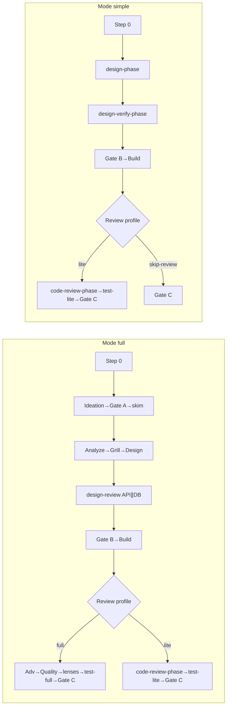

# my-dev-flow stage index (canonical)

Orchestrator only. Stage prompts live in subflows.  
**SoT for:** Happy path (Full/Simple numbered lists), Mode, Review profile, mid-run reclassify, resume, Speed defaults, abort, design-backloop, Status vs stage, Gates, Orchestrator rules.

| Concern | File |
|---------|------|
| HITL / Gate B veto / Build armed / Gate C bar | [hitl.md](hitl.md) |
| Result first-line tokens | [results.md](results.md) |
| Card → which files next | [parent-next.md](parent-next.md) · `lint-run.py --next` |
| Models · lenses · verify · handoffs · invariants · failures · lint · solo · legacy | [models.md](models.md) · [lenses.md](lenses.md) · [verify-and-fix.md](verify-and-fix.md) · [handoffs.md](handoffs.md) · [invariants.md](invariants.md) · [failure-playbook.md](failure-playbook.md) · [scripts/lint-run.py](scripts/lint-run.py) · [solo-entry.md](solo-entry.md) · [LEGACY.md](LEGACY.md) |

**Progress:** ≤5 lines + path after each step; Result header ~40 lines; update card. Paths + Task descriptions: [handoffs.md](handoffs.md).

## Status vs stage id (SoT)

| Field | Allowed | Role |
|-------|---------|------|
| **Status** | `running` \| `paused` \| `stopped` \| `done` | Lifecycle only |
| **Last stage** / card **Stage id** | handoffs ids (+ `gate-b` / `gate-c`) | Pipeline position |

Do **not** store stage names in Status.

**Done criteria:** `done` **only** after Merge Result **success** **and** `merge` ∈ **Gate C approved**. Abort/reject/cancel → `stopped`. Not `done` while paused at Gate C or after commit/PR-only subsets. Re-open `done` only with new slug or explicit Decision.

**Calibration (required after `done`):** ≤3 structured Notes lines on `00-run.md`, **and** append the same ≤3 lines to `.my-docs/workflow/_calibration.md` (create if missing; newest block at bottom with slug + UTC date):
1. `Mode OK?` yes|no — one-line why
2. `Review profile OK?` yes|no — one-line why
3. `Biggest friction stage?` `<stage-id>` — one-line why

Template seed optional: [artifacts/_calibration.md](artifacts/_calibration.md). Append after `done` is required; lint **warns** when Status=`done` lacks Notes lines or a `_calibration.md` block.

---

## Happy path (runtime SoT)

**One numbered list per Mode** below (agent SoT). Diagram is human overview only.

**Skip-review / Smoke after Build (Build-writes-Smoke) legality** (once): [lenses.md](lenses.md) · [verify-and-fix.md](verify-and-fix.md) · [hitl.md](hitl.md).

*Footnote:* skip-review legality: [lenses.md](lenses.md). Mode **full** has no skip-review edge.

### Mode × Review profile → post-Build path

**SoT table (do not duplicate elsewhere — link here).** Post-Build review + test follows Review profile, not Mode. Mode full + profile lite uses the lite path.

| Mode | Review profile | After Build verify-pass + Smoke section |
|------|----------------|------------------------------------------|
| **full** | **full** | Build-writes-Smoke skip → Adv → Quality → lenses → `test-full` → Gate C → merge → `done` |
| **full** | **lite** | Build-writes-Smoke skip → `code-review-phase` → lenses per plan → `test-lite` → Gate C → merge → `done` |
| **simple** | **lite** | Build-writes-Smoke skip → `code-review-phase` → lenses per plan → `test-lite` → Gate C → merge → `done` |
| **simple** | **skip-review** | Legal path → Gate C → merge → `done` ([lenses.md](lenses.md) · [hitl.md](hitl.md)); else drop |

**Forbidden combos (lint error):** Mode **simple** + Review profile **full** (want Adv→Quality→`test-full` → use Mode **full**, or keep simple with **lite** / **skip-review**). Mode **full** + **skip-review**: [lenses.md](lenses.md). Hard stops: [failure-playbook.md](failure-playbook.md). Design wrong after Build → [Design-backloop](#design-backloop-after-build).

### Full pipeline order

1. Step 0 — Mode full; profile full|lite; models + card + HITL; Lens plan **none**; Gate B veto **none**; **lint** `00-run.md`
2. Ideation (set Has UI)
3. Gate A — day-to-day + 80/20 → `01a` (auto when ok; ideation-update ↔ gate-a until ok or round=3; pause for human only at max 3 or escalate)
4. Light skim → `02-skim.md` — **fail-closed:** do not launch skim+ while `01a` ≠ `ok` (`lint-run.py --next` / `--derive` → `do-not-launch`; [parent-next.md](parent-next.md))
5. Analyze → Grill (or skip) → Design (two options); refine Has API/DB
6. Design ↔ review until clean — Has API **and** Has DB: **must** parallel API ∥ DB (unless tiny tweak), then general; max 3; **Pending parallel** ([artifacts/00-run.md](artifacts/00-run.md))
7. 4a — TDD only if planned tests
8. Gate B — HITL + digest ([hitl.md](hitl.md)). Mode **full** → **blocking** only (never async-notify). On settle: **blocking** → set **Gate B approved** `yes` (or named pick) + veto `none` before Build. Async-notify path: Simple step 4 / [hitl.md](hitl.md).
9. Build (veto `none` + **Gate B approved** when blocking + **Build armed** if async → Verify → `verify-pass` + Smoke section; max 3) — Result tokens: [results.md](results.md)
10. Smoke Task skipped on smoke-pass (Build-writes-Smoke); else re-run; fail → Fix → verify-pass → re-smoke
11. Review ⇄ Fix (verify-pass before re-review; max 3) — **by Review profile:**
    - **full** — Lens plan (default none) → Adv → Quality → lenses (Merge if 2+)
    - **lite** — `code-review-phase` → lenses per plan (Merge if 2+)
12. Test ⇄ Fix (max 3; verify-pass before re-test) — **by Review profile:**
    - **full** — `test-full` (one Task)
    - **lite** — `test-lite`
13. Gate C blocking → merge → Status **`done`** only when Merge Result **success** **and** `merge` ∈ Gate C approved + **calibration** Notes + append `_calibration.md` (PR-only → stay `paused`)

### Simple pipeline order

Skip Ideation / Gate A / skim. Prefer phase bundles.

1. Step 0 — Mode simple; Review profile **lite** or **skip-review** only (**never** profile **full** — lint error; want full review → Mode **full**); Lens plan **none**; Gate B veto **none**; Status `running`; bootstrap `01-idea` if needed; **lint**
2. `design-phase` — Analyze + Grill (or skip) + Design; set Verify commands + Has API/DB
3. `design-verify-phase` until clean; max 3
4. 4a if planned → Gate B → Build (veto `none` + **Gate B approved** when blocking + **Build armed** if async + verify-pass + Smoke). Gate B tier per [hitl.md](hitl.md): Mode simple low-risk → prefer **auto**; **async-notify** only when user asks for a veto window / async digest (narrow rule); else **blocking**. On settle: **blocking** → set **Gate B approved** before Build; **auto** may leave it `none`; **async-notify** → gap + **Build armed**.
5. After smoke-pass (Smoke Task usually skipped):
   - **(a) Legal skip-review** — per [lenses.md](lenses.md) → Gate C → merge → **`done`** when `merge` ∈ Gate C approved ([hitl.md](hitl.md))
   - **(b)** drop skip-review ([lenses.md](lenses.md)) → `code-review-phase` → `test-lite` → Gate C → **`done`** when `merge` ∈ Gate C approved
   - **Else (lite)** — `code-review-phase` → `test-lite` → Gate C → **`done`** when `merge` ∈ Gate C approved
6. After Merge Result **success** **and** `merge` ∈ Gate C approved → Status **`done`** + **calibration** Notes + append `_calibration.md` (PR-only → stay `paused`)

Pointers: [verify-and-fix.md](verify-and-fix.md) · [grill.md](grill.md) · [invariants.md](invariants.md) · [parent-next.md](parent-next.md).

---

## Slug

**`YYYYMMDD-feature-x`** (UTC + kebab). Folder: `.my-docs/workflow/<slug>/`.

## Cheap path matrix

| Ask looks like | Mode | Review profile |
|----------------|------|----------------|
| Copy / token / docs-only | simple | skip-review |
| Bug fix / one helper / one field / tiny UI | simple | lite |
| Clear small feature, no new auth/schema | simple | lite |
| New/changed public API or persistence | **full**, unless [tiny tweak](lenses.md) → simple + lite | never skip-review; Has API/DB **yes** |
| Ambiguous / invent *what* | full **or** [myplan first](#step-0--classify--resolve-models--create-run) | full |

Ambiguous → Decision N. API/DB rule: [lenses.md](lenses.md).

---

## Step 0 — Classify + resolve models + create run

0. **Skills sync (hard stop when `AI/skills/my-dev-flow` exists):** run `./AI/skills/sync-to-cursor.sh --check` (or full sync). Drift → **stop**; do not classify until SoT ↔ `~/.cursor/skills` matches ([skills-path.md](skills-path.md)).
1. **When NOT to run / invent *what*:** ask invents product scope with no framing/spec/`01-idea` → **Decision N**: **myplan** first (`{myplan}` via [skills-path.md](skills-path.md)) vs Mode **full** Ideation. Do not invent scope silently.
2. **Overrides:** resume keeps Mode + profile. User `simple`/`full` → Mode. User `skip-review` → profile skip-review (implies simple unless Decision N).
3. Else **3-question classify** (map to Mode; Decision N only if still ambiguous):
   1. **Outcome clear?** yes → lean simple; no → lean full (or myplan if inventing *what*).
   2. **API/DB?** new/changed public API or persistence → full (unless [tiny tweak](lenses.md)); no → lean simple.
   3. **Invent *what*?** yes → myplan Decision N or Mode full Ideation; no → proceed with Mode from (1)+(2) + cheap path.
4. Create slug; write `00-run.md` from [artifacts/00-run.md](artifacts/00-run.md): Status `running`, Mode, profile, Complexity (one-line), Has UI/API/DB when known, Lens plan **none**, **Pending parallel: none**, Gate B veto **none**, models ([models.md](models.md)), card, HITL Gate B ([hitl.md](hitl.md) Default Gate B — full → **blocking**; simple low-risk → prefer **auto**; **async-notify** only when user asks for a veto window / async digest), HITL Grill (full → async-notify; simple → auto), HITL Gate C **blocking**.
5. **Lint (required):** `scripts/lint-run.py .my-docs/workflow/<slug>/` (again `--before-design-review` / `--before-build` / `--before-code-review` / `--before-merge`). Optional: `--check-stage-ids` after editing handoffs/parent-next/stages; `--check-results` for Result tokens + size soft warns.
6. Chat one line: Mode + profile + why.

### Mode selection

| Signal | Prefer **simple** | Prefer **full** |
|--------|-------------------|-----------------|
| Scope | Bug fix, tweak, copy/token, one helper/field (tiny only) | New feature, multi-surface, product concept, non-tiny API/DB |
| Clarity | Outcome clear | Needs discovery / 80/20 |
| Framing | Thin idea from ask, or framing done | Needs Ideation → Gate A → skim |
| Risk | Low blast; no new auth; persistence only if tiny | Cross-cutting auth, schema, multi-app |
| UI | None / copy / tiny match | New multi-surface UX (in Design; no UI concept step) |

Rubber-stamp ask → **simple**. Invent *what* → **full** or myplan first. **Complexity** = one-line reason, not a second classifier.

### Review profile

| Profile | When | After Build (review + test) |
|---------|------|------------------------------|
| **full** | Mode **full** only (default for Mode full). **Forbidden** with Mode simple | See [Mode × profile](#mode--review-profile--post-build-path) |
| **lite** | Mode simple default; also allowed with Mode full | See [Mode × profile](#mode--review-profile--post-build-path) |
| **skip-review** | Mode simple only; legality ([lenses.md](lenses.md)) | See [Mode × profile](#mode--review-profile--post-build-path) · [hitl.md](hitl.md) |

Mode **simple** may use **lite** or **skip-review** only. Profile **full** requires Mode **full** (or reclassify).

### Mid-run reclassify

Scope grows (API/DB yes, auth/PII, multi-surface, blast radius): **Decision N** ([invariants.md](invariants.md)); drop **skip-review** when contracts appear ([lenses.md](lenses.md)).

---

## Resume (mid-run)

1. Read `00-run.md`: Status, Last stage, card, Gates, profile, Mode, Gate B veto, Pending parallel.
2. Do not re-classify unless asked or scope changed.
3. Do not redo completed gates unless artifacts changed.
4. Next = first incomplete Full/Simple step, or card Next step / Stage id ([LEGACY.md](LEGACY.md) for Status-as-stage). Card is override; optional `lint-run.py <run-dir> --next --derive` diffs card vs derived next ([parent-next.md](parent-next.md); optional `tdd-review` until 04a / Notes skip — [lenses.md](lenses.md)).
5. One subflow `SKILL.md`; prompt = **required** `python3 {my-dev-flow}/scripts/handoff-for.py <stage-id>` + **`stages/<stage-id>.md`** ([parent-next.md](parent-next.md) · [skills-path.md](skills-path.md); handoffs.md = edit SoT / debug only).
6. `stopped` → new Decision; `done` → new slug or explicit re-open.
7. Gate B veto `pending` → do not Build. Blocking without **Gate B approved** → do not Build ([hitl.md](hitl.md)).
8. async-notify gap: Notes veto window / paused + Next `build` + veto `none` → this resume **is** next parent turn — set **Build armed**, then launch ([hitl.md](hitl.md)).

---

## Speed defaults

| Rule | Mode **simple** | Mode **full** |
|------|-----------------|---------------|
| Design | One `design-phase` | Analyze → Grill → Design |
| Verify | One `design-verify-phase` | API ∥ DB parallel when both (except [tiny tweak](lenses.md)) → general |
| Code review + Test | **By Review profile** (below) — not by Mode | **By Review profile** (below) — Mode full + lite still uses lite path |
| Lens plan | **none** | **none** then signals |
| Model | Prefer **Fast** ([models.md](models.md)) | Medium when available |

**Review profile → post-Build:** use the SoT table [Mode × Review profile → post-Build path](#mode--review-profile--post-build-path) (do not restate here).

API ∥ DB both yes (not tiny): **same-turn** parallel isolated Tasks. Simple folds into `design-verify-phase`.

---

## Abort / scope-change

- Reject gate / stop / abort / cancel → Status `stopped` + Notes frozen stage + reason.
- Scope change → Decision N (reclassify / new slug / continue). Not Gate C approval.
- Silence at blocking gate → `paused` (do not invent approval).
- Design invalid after Build → [Design-backloop](#design-backloop-after-build).
- Merge Result success + `merge` ∈ Gate C approved → `done` + calibration Notes + `_calibration.md` append. Soft Task-count / main-thread fallbacks: [invariants.md](invariants.md). Scripts: [failure-playbook.md](failure-playbook.md).

---

## Design-backloop after Build

**When:** Fix/verify-fail cannot stay aligned with `03`/`04` without contract/IA change; review Major/Critical needs design change; parent/user says design wrong after Build.

**Do not:** silently amend `03`/`04` in Build/Fix; do not go to Gate C.

**Decision N** ([invariants.md](invariants.md)): Amend design / Fix-only / Stop. After **Option 1**:

1. Log Notes bullet `- design-backloop`; prior Gate B **invalid**.
2. Set **`Gate B approved: none`**; clear Notes **Build armed** and veto-window tokens.
3. If prior `05-review-log` / `06-test-log` Results exist: add Notes `- review-stale` and `- test-stale` (or clear those Results) so derive / `--before-merge` will not treat old clean/success as paid before Gate C ([verify-and-fix.md](verify-and-fix.md)).
4. Card Next = `design-update` (not `build`). Decision N Option 1 is the entry — design-update accepts Notes `design-backloop` without a prior `03a` Fix ask ([design-update.md](../my-dev-flow-design/stages/design-update.md)).
5. Resume design-update → design-review / design-verify-phase → **Gate B** (Next=`gate-b` while token still present) → Fix/Build.
6. After fresh Gate B settle, clear Notes `- design-backloop` by HITL tier (same parent turn as settle):
   - **blocking** — clear token + set **Gate B approved** `yes` / named pick
   - **auto** — clear token after digest settle; approved may stay `none`
   - **async-notify** — clear token + **Build armed** rules ([hitl.md](hitl.md))
   Then Build when armed. Lint still errors while token present (blocks Build for all tiers). Clear `review-stale` / `test-stale` only after fresh review clean / test success.

Lint: Notes `- design-backloop` → **error** on `--before-build` or Next=`build` until cleared (blocks Build even when Gate B is soft); default lint with Next in recovery (`design-update` / design-review / `design-verify-phase` / `gate-b` / …) → **warn** recovery in progress. `--next` redirects **`build`** only (not `gate-b`); Next=`gate-b` + token → normal Gate B digest / settle path. `--next --derive` mirrors this (token + `gate-b` / review clean → derive `gate-b`, not `design-update`).

Gate B veto after Build is separate ([hitl.md](hitl.md) re-open Gate B).

---

## Gates

| Gate | When | Who |
|------|------|-----|
| **A** | After Ideation (full) | User-role → `01a`; auto when ok |
| **B** | After design-review (+ 04a); before Build | HITL ([hitl.md](hitl.md)) |
| **C** | Before commit/push/PR/merge | Always blocking |

---

## Orchestrator rules (short)

- Honor Full/Simple order above; one subflow at a time.
- Before each Task: [invariants.md](invariants.md); **required** `python3 {my-dev-flow}/scripts/handoff-for.py <stage-id>`.
- Design-review update → re-review. Smoke/test fail → Fix (verify-pass) → re-run.
- No advance on verify-fail; max 3 → Decision N. Design invalid → Design-backloop.
- Card Next step = stage id (+ description from `handoff-for.py` / [handoffs.md](handoffs.md) SoT).
- Mode full Task count ≥20 → Decision N ([invariants.md](invariants.md)).
