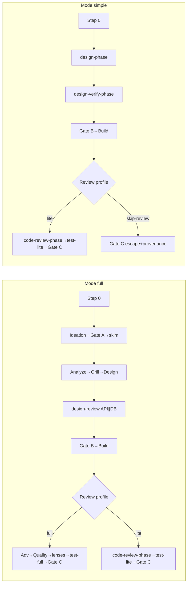

# my-dev-flow stage index (canonical)

Orchestrator only. Stage prompts live in subflows.  
**SoT for:** Happy path (Full/Simple numbered lists), Mode × Review profile post-Build path, Status vs stage, Slug, Cheap path, Speed defaults, Gates.

| Concern | File |
|---------|------|
| Step 0 / Load budget / Mode / profile / mid-run reclassify | [step-0.md](step-0.md) |
| Resume / abort / scope-change | [resume-abort.md](resume-abort.md) |
| Design-backloop after Build | [design-backloop.md](design-backloop.md) |
| Orchestrator rules (short) | [orchestrator-rules.md](orchestrator-rules.md) |
| HITL / Gate B veto / Build armed / Gate C bar | [hitl.md](hitl.md) |
| Result first-line tokens | [results.md](results.md) |
| Card → which files next | [parent-next.md](parent-next.md) · `lint-run.py --next` |
| Models · lenses · verify · handoffs · invariants · failures · lint · solo · legacy | [models.md](models.md) · [lenses.md](lenses.md) · [verify-and-fix.md](verify-and-fix.md) · [handoffs.md](handoffs.md) · [invariants.md](invariants.md) · [failure-playbook.md](failure-playbook.md) · [scripts/lint-run.py](scripts/lint-run.py) · [solo-entry.md](solo-entry.md) · [LEGACY.md](LEGACY.md) |

**Progress:** ≤5 lines + path after each step; Result header ~40 lines; update card. Paths + Task descriptions: [handoffs.md](handoffs.md).

## Status vs stage id (SoT)

| Field | Allowed | Role |
|-------|---------|------|
| **Status** | `running` \| `paused` \| `stopped` \| `done` | Lifecycle only |
| **Last stage** / card **Stage id** | handoffs ids (+ `gate-b` / `gate-c`) | Pipeline position |

Do **not** store stage names in Status.

**Done criteria:** `done` **only** after Merge Result **success** **and** `merge` ∈ **Gate C approved**. Abort/reject/cancel → `stopped`. Not `done` while paused at Gate C or after commit/PR-only subsets. Re-open `done` only with new slug or explicit Decision.

**Calibration (required after `done`):** ≤3 structured Notes lines on `00-run.md`, **and** append the same ≤3 lines to `.my-docs/workflow/_calibration.md` (create if missing; newest block at bottom with slug + UTC date):
1. `Mode OK?` yes|no — one-line why
2. `Review profile OK?` yes|no — one-line why
3. `Biggest friction stage?` `<stage-id>` — one-line why

Template seed optional: [artifacts/_calibration.md](artifacts/_calibration.md). Append after `done` is required; lint **warns** when Status=`done` lacks Notes lines or a `_calibration.md` block.

---

## Happy path (runtime SoT)

**One numbered list per Mode** below (agent SoT). Diagram is human overview only.

**Skip-review / Smoke after Build (Build-writes-Smoke) legality** (once): [lenses.md](lenses.md) · [verify-and-fix.md](verify-and-fix.md) · [hitl.md](hitl.md).

*Footnote:* skip-review → Gate C is **fail-closed** (Build-writes-Smoke alone is not enough) — [hitl.md](hitl.md) Gate C test bar. Legality: [lenses.md](lenses.md). Mode **full** has no skip-review edge.

### Mode × Review profile → post-Build path

**SoT table (do not duplicate elsewhere — link here).** Post-Build review + test follows Review profile, not Mode. Mode full + profile lite uses the lite path.

| Mode | Review profile | After Build verify-pass + Smoke section |
|------|----------------|------------------------------------------|
| **full** | **full** | Build-writes-Smoke skip → Adv → Quality → lenses → `test-full` → Gate C → merge → `done` |
| **full** | **lite** | Build-writes-Smoke skip → `code-review-phase` → lenses per plan → `test-lite` → Gate C → merge → `done` |
| **simple** | **lite** | Build-writes-Smoke skip → `code-review-phase` → lenses per plan → `test-lite` → Gate C → merge → `done` |
| **simple** | **skip-review** | Legal path → Gate C → merge → `done` **only** when Gate C fail-closed bar met ([hitl.md](hitl.md)); else drop ([lenses.md](lenses.md)) |

**Forbidden combos (lint error):** Mode **simple** + Review profile **full** (want Adv→Quality→`test-full` → use Mode **full**, or keep simple with **lite** / **skip-review**). Mode **full** + **skip-review**: [lenses.md](lenses.md). Hard stops: [failure-playbook.md](failure-playbook.md). Design wrong after Build → [design-backloop.md](design-backloop.md).

### Full pipeline order

1. Step 0 — Mode full; profile full|lite; models + card + HITL; Lens plan **none**; Gate B veto **none**; **lint** `00-run.md` ([step-0.md](step-0.md))
2. Ideation (set Has UI)
3. Gate A — day-to-day + 80/20 → `01a` (auto when ok; ideation-update ↔ gate-a until ok or round=3; pause for human only at max 3 or escalate)
4. Light skim → `02-skim.md` — **fail-closed:** do not launch skim+ while `01a` ≠ `ok` (`lint-run.py --next` / `--derive` → `do-not-launch`; [parent-next.md](parent-next.md))
5. Analyze → Grill (or skip) → Design (two options); refine Has API/DB
6. Design ↔ review until clean — Has API **and** Has DB (not tiny tweak): both `03a-*` missing → **same-turn** parallel API ∥ DB; one `03a-*` exists → launch **missing only** (resume serialize) — [lenses.md](lenses.md) · derive H3; then general; max 3; **Pending parallel** ([artifacts/00-run.md](artifacts/00-run.md))
7. 4a — TDD only if planned tests
8. Gate B — HITL + digest ([hitl.md](hitl.md)). Mode **full** → **blocking** only (never async-notify). On settle: **blocking** → set **Gate B approved** `yes` (or named pick) + veto `none` **+ quality provenance** ([hitl.md](hitl.md)) before Build. Async-notify path: Simple step 4 / [hitl.md](hitl.md).
9. Build (veto `none` + **Gate B approved** when blocking + **Build armed** if async → Verify → `verify-pass` + Smoke section; max 3) — Result tokens: [results.md](results.md)
10. Smoke Task skipped on smoke-pass (Build-writes-Smoke); else re-run; fail → Fix → verify-pass → re-smoke
11. Review ⇄ Fix (verify-pass before re-review; max 3) — **by Review profile:**
    - **full** — Lens plan (default none) → Adv → Quality → lenses (Merge if 2+)
    - **lite** — `code-review-phase` → lenses per plan (Merge if 2+)
12. Test ⇄ Fix (max 3; verify-pass before re-test) — **by Review profile:**
    - **full** — `test-full` (one Task)
    - **lite** — `test-lite`
13. Gate C blocking → merge → Status **`done`** only when Merge Result **success** **and** `merge` ∈ Gate C approved **+ quality provenance** ([hitl.md](hitl.md)) + **calibration** Notes + append `_calibration.md` (PR-only → stay `paused`)

### Simple pipeline order

Skip Ideation / Gate A / skim. Prefer phase bundles.

1. Step 0 — Mode simple; Review profile **lite** or **skip-review** only (**never** profile **full** — lint error; want full review → Mode **full**); Lens plan **none**; Gate B veto **none**; Status `running`; bootstrap `01-idea` if needed; **lint** ([step-0.md](step-0.md))
2. `design-phase` — Analyze + Grill (or skip) + Design; set Verify commands + Has API/DB
3. `design-verify-phase` until clean; max 3
4. 4a if planned → Gate B → Build (veto `none` + **Gate B approved** when blocking + **Build armed** if async + verify-pass + Smoke). Gate B tier per [hitl.md](hitl.md): Mode simple low-risk → prefer **auto**; **async-notify** only when user asks for a veto window / async digest (narrow rule); else **blocking**. On settle: **blocking** → set **Gate B approved** **+ quality provenance** ([hitl.md](hitl.md)) before Build; **auto** may leave it `none`; **async-notify** → gap + **Build armed**.
5. After smoke-pass (Smoke Task usually skipped):
   - **(a) Legal skip-review** — per [lenses.md](lenses.md) → Gate C **only when** Gate C test bar escape **+ provenance** met ([hitl.md](hitl.md)); Build-writes-Smoke alone is not enough → merge → **`done`** when `merge` ∈ Gate C approved **+ quality provenance**
   - **(b)** drop skip-review ([lenses.md](lenses.md)) → `code-review-phase` → `test-lite` → Gate C → **`done`** when `merge` ∈ Gate C approved **+ quality provenance** ([hitl.md](hitl.md))
   - **Else (lite)** — `code-review-phase` → `test-lite` → Gate C → **`done`** when `merge` ∈ Gate C approved **+ quality provenance** ([hitl.md](hitl.md))
6. After Merge Result **success** **and** `merge` ∈ Gate C approved **+ quality provenance** ([hitl.md](hitl.md)) → Status **`done`** + **calibration** Notes + append `_calibration.md` (PR-only → stay `paused`)

Pointers: [verify-and-fix.md](verify-and-fix.md) · [grill.md](grill.md) · [invariants.md](invariants.md) · [parent-next.md](parent-next.md) · [step-0.md](step-0.md) · [resume-abort.md](resume-abort.md).

---

## Slug

**`YYYYMMDD-feature-x`** (UTC + kebab). Folder: `.my-docs/workflow/<slug>/`.

## Cheap path matrix

| Ask looks like | Mode | Review profile |
|----------------|------|----------------|
| Copy / token / docs-only | simple | skip-review |
| Bug fix / one helper / one field / tiny UI | simple | lite |
| Clear small feature, no new auth/schema | simple | lite |
| New/changed public API or persistence | **full**, unless [tiny tweak](lenses.md) → simple + lite | never skip-review; Has API/DB **yes** |
| Ambiguous / invent *what* | full **or** [myplan first](step-0.md#step-0--classify--resolve-models--create-run) | full |

Ambiguous → Decision N. API/DB rule: [lenses.md](lenses.md).

---

## Speed defaults

| Rule | Mode **simple** | Mode **full** |
|------|-----------------|---------------|
| Design | One `design-phase` | Analyze → Grill → Design |
| Verify | One `design-verify-phase` | API ∥ DB: both `03a-*` missing → parallel; one exists → missing only (resume serialize) — [lenses.md](lenses.md); except [tiny tweak](lenses.md) → general |
| Code review + Test | **By Review profile** (below) — not by Mode | **By Review profile** (below) — Mode full + lite still uses lite path |
| Lens plan | **none** | **none** then signals |
| Model | Prefer **Fast** ([models.md](models.md)) | Medium when available |

**Review profile → post-Build:** use the SoT table [Mode × Review profile → post-Build path](#mode--review-profile--post-build-path) (do not restate here).

API ∥ DB both yes (not tiny): both `03a-*` missing → **same-turn** parallel isolated Tasks; one exists → launch missing only (resume serialize) — [lenses.md](lenses.md). Simple folds into `design-verify-phase`.

---

## Gates

| Gate | When | Who |
|------|------|-----|
| **A** | After Ideation (full) | User-role → `01a`; auto when ok |
| **B** | After design-review (+ 04a); before Build | HITL ([hitl.md](hitl.md)) |
| **C** | Before commit/push/PR/merge | Always blocking |
